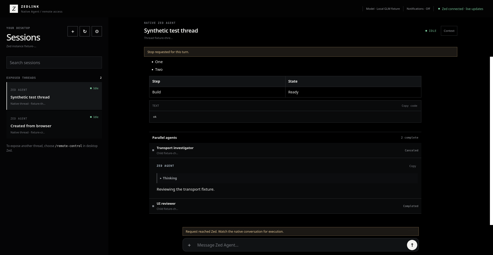
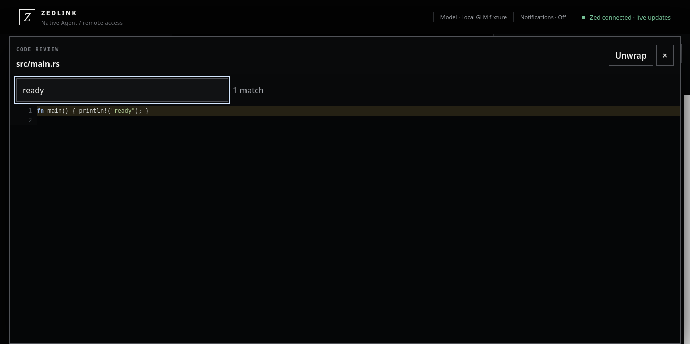

# ZedLink

<p align="center">
  <strong>Secure remote control for agent conversations hosted in Zed.</strong><br>
  Continue the same Zed Agent, Codex, Claude Code, or other ACP conversation from a phone, tablet, or desktop browser while its runtime, tools, permissions, and project context remain inside Zed.
</p>

<p align="center">
  <code>Linux host</code> · <code>Private HTTPS</code> · <code>Installable PWA</code> · <code>SwiftUI</code> · <code>Android</code>
</p>



> [!IMPORTANT]
> ZedLink is working development software built against pinned Zed revision `76659a55a8c10ed355a070f8764a0b1733e3c115`. It currently requires the included Zed source patch and is not a Marketplace extension. A physical iPhone Safari client has completed a same-thread round trip over trusted Tailscale HTTPS.

## What ZedLink does

ZedLink exposes only the root Agent threads you explicitly enable with `/remote-control`. Prompts from a paired client enter the selected thread's normal execution path and appear in the desktop Agent Panel. Responses, reasoning, tools, approvals, errors, cancellations, and filesystem state stay tied to that same conversation. Zed's native Agent keeps its configured model and profiles; ACP agents such as Codex and Claude Code keep their own runtime, authentication, model, and configuration.

| Capability | Current support |
| --- | --- |
| Existing native Agent threads | List, expose, resume, stream, and stop |
| External ACP agents | Existing Codex, Claude Code, OpenCode, Copilot, Cursor, and other Zed-hosted ACP threads can be exposed and are labeled by agent |
| New Agent sessions | Create in the configured project from the browser |
| Agent activity | Live responses, thinking, tool calls, output, errors, retries, and parallel agents |
| Project context | Browse and search files, attach context, inspect syntax-highlighted code and diffs |
| Decisions | Approve once or deny pending native tool requests |
| Private access | Explicit device pairing over Tailscale, routed VPNs, or trusted HTTPS profiles |
| Clients | Responsive browser/PWA, SwiftUI source, and Jetpack Compose source |

```text
Browser or app ── authenticated private HTTPS ── ZedLink gateway
                                                        │
                                                 local Unix socket
                                                        │
                                                        ▼
                                               selected Zed-hosted thread
                                               using its existing runtime
```

Zed must remain open while a remote conversation is active. Model credentials never leave the workstation.

## Interface

The browser interface uses the same responsive layout as the installable home-screen app. It provides compact mobile chat, expandable live activity, tool output, code review, connection diagnostics, and session controls.

<table>
  <tr>
    <td width="38%"></td>
    <td width="62%"></td>
  </tr>
  <tr>
    <td align="center"><strong>Mobile conversation</strong></td>
    <td align="center"><strong>Searchable code review</strong></td>
  </tr>
</table>

<sub>Screenshots are produced by the deterministic authenticated browser fixture. They verify the rendered client behavior; native integration evidence is listed under <a href="#validation-and-limitations">Validation and limitations</a>.</sub>

## Quick start

1. Open this repository in Zed and trust the worktree.
2. Open the command palette with `Ctrl+Shift+P`, run **task: spawn**, then choose **ZedLink: Set up this project**.
3. Open **ZedLink — Patched Zed** from your Linux application menu and use that `Zed Dev` window for remote sessions.
4. In a root Zed Agent or external ACP agent conversation, run `/remote-control`.
5. Run **ZedLink: Start gateway**, followed by **ZedLink: Pair a device**.
6. Open or scan the private HTTPS address, enter the one-time code, select the exposed session, and send a message.

The sections below explain every step, custom network routes, troubleshooting, security, and validation in detail.

## Why `zed-source/` is on the workstation but not GitHub

`zed-source/` is a generated local checkout of the maintained [`tjnull/zed`](https://github.com/tjnull/zed/tree/zedlink/native-agent-remote-control) fork on branch `zedlink/native-agent-remote-control`. That branch is based on the pinned official Zed revision and contains the native ZedLink integration. The installer builds the patched `zed` executable under `zed-source/target/`, keeps `tjnull/zed` as `origin`, and records `zed-industries/zed` as `upstream`.

The directory is intentionally ignored by the ZedLink repository and is never copied into `tjnull/zedlink`. The reviewable [source patch](patches/zed-1.22.0-local-probe.patch) mirrors the fork changes for auditing and compatibility checks. If `zed-source/` is missing, the installer recreates it directly from the fork branch.

Keep it while using or rebuilding patched Zed. It can be deleted to recover disk space only after closing Zed Dev and accepting that the next **ZedLink: Install / build** will clone and compile Zed again. Deleting it is not required before committing or pushing ZedLink changes.

## Before you begin

You need:

- A Linux computer with this repository.
- Your model already working in normal Zed.
- Rust, Cargo, Git, Python 3, and the [Zed Linux build dependencies](https://github.com/zed-industries/zed/blob/76659a55a8c10ed355a070f8764a0b1733e3c115/docs/src/development/linux.md).
- Tailscale connected on both the Zed computer and client device, or another private network route.
- A trusted TLS certificate for the hostname the client browser will open.
- Python's `qrcode` package for the easiest browser pairing flow.

The first patched Zed build can take a while. Later starts use the existing build.

## First-time setup in Zed

### 1. Open this repository

In Zed:

1. Open the **File** menu.
2. Select **Open Folder**.
3. Open:

   ```text
   /home/you/Documents/projects/zedlink
   ```

4. If Zed displays **Restricted Mode**, select **Trust and Continue**.

Trust is required because the project includes tasks that build and start local programs.

### 2. Open the Zed task picker

A Zed task is a saved command that runs in Zed's integrated terminal.

1. Press `Ctrl+Shift+P` to open the command palette.
2. Type `task: spawn`.
3. Select **task: spawn**.
4. Type `ZedLink`.

You should see tasks such as:

- **ZedLink: Set up this project**
- **ZedLink: Guided setup / update**
- **ZedLink: Install / build**
- **ZedLink: Configure**
- **ZedLink: Diagnose setup**
- **ZedLink: Repair setup**
- **ZedLink: Install patched Zed launcher**
- **ZedLink: Start patched Zed**
- **ZedLink: Start gateway**
- **ZedLink: Pair a device**
- **ZedLink: Status**

If no ZedLink tasks appear, make sure the ZedLink repository is the folder currently open in Zed.

### Fast setup for this workstation

The global tasks are already installed on this workstation. To configure whichever project is open in Zed:

1. Open that project in Zed.
2. Press `Ctrl+Shift+P` and select **task: spawn**.
3. Run **ZedLink: Set up this project**.

That single task uses Zed's current `$ZED_WORKTREE_ROOT`, builds the pinned Zed and gateway if needed, detects the Tailscale address and MagicDNS hostname, reuses or creates the private TLS files, saves the configuration, and installs the global management tasks. If a usable configuration already exists, it preserves the route, certificate, state, and Zed profile while changing only the selected project.

The only possible first-run question is permission to request a Tailscale certificate when no matching certificate exists. That confirmation remains because certificate issuance publishes the hostname in public Certificate Transparency logs.

### Configure ZedLink in Zed Settings

The patched Zed build now has a native **ZedLink** Settings page. Open it with `Ctrl+,`, then select **ZedLink** in the left sidebar. It contains:

- **Enable ZedLink** — starts the private local bridge whenever patched Zed starts.
- **Private State Directory** — normally `~/.local/state/zedlink` written as a full absolute path.
- **Project Root** — the project whose Agent threads may be exposed.
- **Start Gateway on Launch** — starts the saved private HTTPS gateway with patched Zed.
- **ZedLink Manager** — the installer-managed path used to load connection and TLS profiles.
- **Remote Permissions** — separate controls for new sessions, attachments, project browsing, Git changes, approval decisions, and Agent settings.

Open **Connection Providers** at the top of the ZedLink page to manage the private route used by browsers and apps. The subpage supports Tailscale, NetBird, WireGuard, ZeroTier, Twingate, Headscale, Cloudflare Tunnel + Access, SSH reverse tunnels, direct SSH forwarding, local LAN HTTPS, and custom private HTTPS.

The **Connection Provider** dropdown displays the provider saved for the selected profile. Choosing another provider updates the fields and instructions beneath it: private network profiles show their routed listener and trusted client origin, while Cloudflare and reverse SSH profiles show the required loopback origin and origin TLS hostname. Hidden proxy-only values are not retained when a direct provider is saved.

To add or update a connection:

1. Enter a short lowercase **Profile ID**, such as `tailscale` or `wireguard-home`.
2. Choose its **Provider**.
3. Choose **Detect Provider Defaults** for Tailscale, Headscale, NetBird, Cloudflare, or SSH. For other providers, enter the private listener address supplied by that network.
4. Review the trusted client HTTPS origin and certificate paths.
5. Choose **Save & Activate**. ZedLink validates the private bind, URL, port, certificate, key permissions, and proxy rules before saving and restarting the gateway.
6. Choose **Check Connection**. ZedLink makes a trusted HTTPS request to the saved endpoint and confirms that it reports this installation's gateway identity.

To switch back to a saved profile, enter its ID and choose **Select Existing Connection**. Invalid or disabled profiles are rejected without replacing the working primary route. Provider applications such as Tailscale, NetBird, WireGuard, ZeroTier, and Twingate still own their device authentication, routing, and DNS; ZedLink configures only its authenticated HTTPS listener on the resulting private route.

The check runs from the Zed workstation. A passing result confirms the local provider route, certificate trust, HTTPS listener, and gateway identity from that machine. It cannot prove that a phone or another computer is signed into the provider or can resolve and route to the host; open the same HTTPS origin on that device for the final client-side check.

**ZedLink: Set up this project** fills these settings automatically when the Zed settings file is strict JSON. It enables automatic gateway startup and uses permissive remote controls for the explicitly exposed thread by default. Later setup runs preserve permission switches you turned off. If the file contains JSON comments, setup preserves it and asks you to enter the values on the ZedLink page instead of deleting your comments. Restart patched Zed after changing these fields.

Run **ZedLink: Diagnose setup** for one health report covering the patched binary, native settings, project and state paths, TLS profiles, local bridge, gateway, and paired-device count. Run **ZedLink: Repair setup** to restore native settings, global tasks, launchers, private directories, and gateway startup. Repair never changes Zed's model provider, model name, endpoint, or credentials.

The task picker remains a bootstrap and maintenance surface for compiling the source patch, configuring TLS routes, and managing the separate gateway process. It is no longer required to inject bridge settings every time Zed starts.

The downloaded Zed from `zed.dev` cannot show this page or `/remote-control`, because the stock extension API cannot add a settings page or control an existing native Agent thread. Open **ZedLink — Patched Zed** from the operating system application menu. Once Zed accepts the native patch upstream or ships an equivalent API, this separate build can be removed.

`/remote-control` still selects the individual conversation that becomes visible. Enabling ZedLink does not expose every Agent conversation.

### 3. Guided setup for custom networking

Select **ZedLink: Guided setup**.

The task opens a terminal and asks three groups of questions:

1. Whether to build patched Zed and the gateway.
2. Whether to save the project and private network configuration.
3. Whether to install global ZedLink tasks.

Use this longer workflow when you need WireGuard, local HTTPS, a reverse proxy, a custom port, a separate Zed profile, or another non-default path. For a first custom installation, answer **yes** to all three.

The global tasks let you access ZedLink from any project later. They preserve unrelated Zed tasks and back up an existing global task file before changing it.

You can run the same guided setup from a terminal:

```sh
cd /home/you/Documents/projects/zedlink
bash tools/setup_zed_ide.sh
```

## Configuration: what each prompt means

Guided setup runs **ZedLink: Configure**. It asks for the following values.

| Prompt | What to enter | Example |
| --- | --- | --- |
| Project to open in patched Zed | The full path of the project whose Agent thread you want to control; this is required | `/home/you/Documents/my-project` |
| Private state directory | Where ZedLink stores its socket, paired-device records, and gateway identity | `/home/you/.local/state/zedlink` |
| Gateway bind address | A private computer IP followed by `:44679` | `100.64.10.20:44679` |
| Client HTTPS origin | The trusted hostname your browser or app opens, with the same port | `https://computer.example-tailnet.ts.net:44679` |
| TLS certificate PEM path | Full path to the certificate for that hostname; detected Tailscale setups receive a durable suggested path | `/home/you/.config/zedlink/tls/computer.example-tailnet.ts.net.crt` |
| TLS private key PEM path | Full path to its private key; detected Tailscale setups receive a matching suggested path | `/home/you/.config/zedlink/tls/computer.example-tailnet.ts.net.key` |
| Existing Zed user data directory | Usually leave blank to use your normal Zed profile | press Enter |

The private key must have restricted permissions:

```sh
chmod 600 /absolute/path/to/computer.key
```

Configuration is saved privately in:

```text
~/.config/zedlink/config.json
```

It stores paths and network settings. It does not store your model API key or copy model credentials to a client.

### Tailscale values

Find the computer's Tailscale IPv4 address with:

```sh
tailscale ip -4
```

Use that address for **Gateway bind address**, followed by port `44679`.

The client URL must use a hostname covered by a certificate trusted by the browser. Do not use the raw Tailscale IP as the HTTPS URL. Tailscale documents certificate creation in [Set up HTTPS certificates](https://tailscale.com/docs/how-to/set-up-https-certificates). Certificate issuance publishes the hostname in public Certificate Transparency logs, and file certificates must be renewed.

When the wizard detects Tailscale and the suggested certificate files do not exist, it explains that public-log consequence and asks whether it should run `tailscale cert` for you. Answering **yes** creates the certificate and private key under `~/.config/zedlink/tls/`; answering **no** leaves certificate management to you and stops configuration without saving partial settings.

On the iPhone:

1. Open Tailscale and connect to the same tailnet.
2. Enable **Use Tailscale DNS settings**.
3. Keep Tailscale connected while using ZedLink.

Do not bypass a Safari certificate warning. Fix the hostname, certificate, or Tailscale DNS configuration instead.

### Other connection options

Tailscale is the validated default, but ZedLink's application protocol is standard authenticated HTTPS and WebSocket traffic. It can travel over another private network or a carefully configured HTTPS frontend without changing the native Zed Agent integration.

The practical choices are:

| Route | When to choose it | Present state |
| --- | --- | --- |
| **NetBird** | A cross-platform, optionally self-hosted WireGuard mesh alternative | Gateway preset and discovery implemented; installed here but currently disconnected and not physically tested |
| **WireGuard** | You want to manage peers, routes, and DNS yourself | Gateway preset implemented; physical route not tested |
| **ZeroTier** | You prefer a private virtual-LAN model | Gateway preset implemented; provider not installed or tested here |
| **Twingate** | A team needs identity-based access to a private ZedLink resource | Private-resource preset implemented; connector path not tested |
| **Headscale** | You want a self-hosted control plane with Tailscale clients | Tailscale-compatible preset implemented; custom control server not tested |
| **Cloudflare Tunnel + Access** | Browsers need access without a device VPN | Loopback listener and safe template implemented; external tunnel and Access policy not configured |
| **SSH reverse tunnel + your VPS** | You want a self-controlled browser route without a device VPN | Loopback listener and Caddy/SSH template implemented; no VPS route tested |
| **Local LAN HTTPS** | Remote access is unnecessary | Works through generic configuration when DNS and TLS are configured correctly |

Direct SSH port forwarding is reasonable for a desktop browser, but it is not a good primary iPhone Safari route and does not remove TLS hostname validation. ZedLink will not expose a generic SSH shell.

The gateway can now keep Tailscale active while adding NetBird, WireGuard, ZeroTier, Twingate, Headscale, a loopback Cloudflare/SSH frontend, or another private HTTPS listener. Keep the working Tailscale route while validating alternatives.

The connection profiles enforce the same pairing and TLS boundaries for every provider. No provider other than Tailscale should be treated as validated until its same-thread, TLS, pairing, WebSocket, reconnect, cancellation, and approval tests are recorded.

#### Configure more than one connection

ZedLink now supports up to 16 enabled private or loopback TLS listeners sharing the same gateway identity, paired devices, native Zed socket, and Agent state. Existing one-route configurations migrate automatically when read; the working Tailscale route is retained.

From Zed:

1. Press `Ctrl+Shift+P` and select **task: spawn**.
2. Run **ZedLink: Manage connections**.
3. Select **Add route** and choose NetBird, WireGuard, ZeroTier, Twingate, Headscale, Cloudflare, SSH reverse, SSH local, LAN, or custom HTTPS.
4. Enter the private listener address, trusted client origin, and certificate files requested by the wizard.
5. Run **ZedLink: Restart gateway** so listener changes take effect.
6. Run **ZedLink: Check connections** to verify trusted HTTPS and the stable gateway identity.
7. Run **ZedLink: Pair a device** and choose the origin reachable from that device.

The route manager can also enable or disable a route, make it the default pairing origin, remove it, or regenerate a frontend template. A route definition starts a gateway listener; it does not sign into a VPN provider, create an external account, alter firewall rules, or publish a tunnel.

Direct private-network routes require an address on that network and a hostname whose certificate is trusted by the client:

- **NetBird:** connect the workstation and client to the same NetBird network, then use the workstation's NetBird IP and a certificate-valid DNS name.
- **WireGuard:** configure peer routes and DNS outside ZedLink, then use the workstation's routed WireGuard address.
- **ZeroTier:** authorize both members on the same network and use the workstation's managed private address.
- **Twingate:** place the chosen private listener behind a Twingate Connector and define its HTTPS hostname and port as a Resource.
- **Headscale:** connect official Tailscale clients to the custom control server and configure the resulting private address as a Tailscale-compatible route.
- **LAN:** use a private LAN address and trusted local hostname. A raw-IP certificate warning is not acceptable.

Proxy routes bind only to `127.0.0.1` or `::1`:

- **Cloudflare Tunnel + Access:** the route manager writes `~/.local/state/zedlink/frontends/ROUTE_ID/cloudflared.yml`. Create a named tunnel and Access self-hosted application, replace the tunnel UUID and credentials path, and run `cloudflared tunnel --config PATH run`. Certificate verification remains enabled between `cloudflared` and ZedLink.
- **SSH reverse + VPS/Caddy:** the manager writes a private Caddyfile containing the TLS upstream configuration and a hardened reverse-forward command template. Install it on the user-controlled VPS, keep the forwarded port bound to VPS loopback, and run the outbound SSH connection from the Zed workstation.
- **Direct SSH:** the manager writes client instructions for a local forward. The desktop client must map the certificate hostname to loopback and open that exact HTTPS hostname. This remains unsuitable as the primary iPhone Safari route.

Cloudflare and the VPS terminate the client-facing TLS session and can see application plaintext. Their authentication is an additional layer; every browser must still pair with ZedLink. Pairing credentials are scoped to an HTTPS origin, so a browser paired through Tailscale must pair separately through a Cloudflare or VPS hostname.

## Start ZedLink

Complete these steps in order.

### 1. Check setup

Open `Ctrl+Shift+P` → **task: spawn** → **ZedLink: Status**.

A ready setup should report:

- the configured project,
- the gateway URL,
- patched Zed as built,
- the gateway binary as built.

If it says **Setup: not configured**, run **ZedLink: Configure**.

### 2. Start patched Zed

After setup, open **ZedLink — Patched Zed** from the Linux application menu. The dedicated square ZedLink icon launches the configured project directly in the patched `Zed Dev` build, so ordinary Zed does not need to be opened first.

If the launcher is missing, run **ZedLink: Install patched Zed launcher** once from the task picker. You can always use **ZedLink: Start patched Zed** as the terminal-backed fallback.

This opens another Zed window using the patched binary. It runs as a separate **Zed Dev** instance while continuing to read your normal Zed settings, including the configured local model. The ordinary Zed window installed by `curl -f https://zed.dev/install.sh | sh` remains the official release and is not modified.

The two windows are different applications:

| Window | Executable | `/remote-control` |
| --- | --- | --- |
| Ordinary Zed | `~/.local/zed.app/libexec/zed-editor` | unavailable |
| Zed Dev for ZedLink | `zed-source/target/debug/zed` | available |

Always open the Agent panel and choose `/remote-control` in the **Zed Dev** window. Neither the launcher nor the task can add the command to an official Zed window that is already running.

If Zed reuses the ordinary window or the patched window does not appear:

1. Save your work.
2. Close other Zed windows using the same profile.
3. Run **ZedLink: Start patched Zed** again.

In the new window, verify that:

- the configured project is open,
- your expected model is selected in the Agent panel,
- the existing native Agent conversations are present.

If the window shows the wrong model, stop there and review the **Existing Zed user data directory** value. ZedLink never selects or replaces your model.

### 3. Expose one Agent thread

In the patched Zed window:

1. Open the Agent panel.
2. Open the conversation you want to access remotely.
3. Click the Agent message composer.
4. Type `/remote-control`.
5. Select **Remote Control** from the command suggestions.

Zed should display:

```text
Thread exposed to ZedLink locally.
```

Only explicitly exposed threads appear in remote clients. Run `/remote-control` again to stop exposing that thread.

After restarting patched Zed, expose the desired thread again.

You can also create a fresh native Agent session from the paired browser after the patched Zed and gateway are running. Open **Sessions**, select **+ New**, optionally enter a title, and select **Create**. ZedLink creates the session inside the configured project with Zed's native Agent and its current model, then exposes it automatically. It cannot choose another project, model, provider, or tool policy from the browser.

### 4. Start the gateway

Return to any Zed window with the global tasks:

1. Open `Ctrl+Shift+P`.
2. Run **task: spawn**.
3. Select **ZedLink: Start gateway**.
4. Leave its terminal running.

The gateway must remain running while a remote client is connected. It binds only to the private address saved during configuration.

Run **ZedLink: Status** again. The native socket and gateway admin should now report online.

### 5. Pair a browser or device

Run **ZedLink: Pair a device**.

A private pairing page opens on the Zed computer. It supports these paths:

- **New browser:** select **Pair a new browser**, scan the QR, or copy the secure pairing link.
- **Phone, Windows PC, or another Linux computer:** scan the QR or select **Copy secure pairing link** and open it in the destination browser through a private channel.
- **Already-installed iPhone home-screen app:** keep the ZedLink app open. Do not scan the QR because iOS sends camera links to the default browser. Compare the HTTPS address and Gateway ID shown on both screens, type the displayed 10-digit code into the installed app, check **I checked this gateway**, and select **Connect ZedLink**.

Confirm Tailscale or your routed VPN is connected on the destination device and that the HTTPS page has no certificate warning. The link, QR, and 10-digit code expire after five minutes and work once. Keep them private.

The browser name and operating system are detected automatically, such as **Firefox on Linux** or **Edge on Windows**, and can be edited before manual pairing. Pairing is saved for the exact HTTPS origin in normal browser storage. Refreshing or opening another normal tab should not require another code. Private browsing and storage-clearing policies may not preserve it.

#### Supported desktop browsers

| Client | Access | Install behavior |
| --- | --- | --- |
| Firefox on Linux or Windows | Full browser interface | Bookmark or pin the page; Firefox desktop does not install the PWA |
| Chrome or Chromium on Linux or Windows | Full browser interface | Installable from the address bar or browser menu when offered |
| Microsoft Edge on Windows | Full browser interface | Installable as an app when offered |
| Safari on iPhone or iPad | Full mobile interface | Add to Home Screen from Share |

The gateway and patched Zed currently run on the configured Linux workstation. Windows support here means a Windows browser can securely control that workstation; it does not yet make Windows a supported ZedLink gateway host.

### Install the website on the home screen

The gateway page is a standalone Progressive Web App with an OLED icon and the same Sessions, Connections, Settings, conversation, activity, tool, command, and composer layout as the native clients. Its service worker caches only the static interface. It explicitly bypasses `/v1/`, so API responses, conversations, pairing exchanges, and credentials are never stored in the offline cache.

On iPhone or iPad:

1. Open the trusted ZedLink HTTPS address in Safari.
2. Tap **Share**.
3. Tap **Add to Home Screen**.
4. Open ZedLink from its new icon.
5. If the installed app asks to pair, run **ZedLink: Pair a device** on the Zed computer. Leave the installed app open and manually enter the 10-digit code; scanning the QR opens the default iOS browser instead of the installed app.

iOS may keep browser and home-screen credentials in separate website-data containers, particularly when the site was installed from a third-party browser. Pairing the installed app once is expected in that case. Its credential then remains scoped to the same trusted HTTPS origin and can be revoked independently.

On Android Chrome:

1. Open the trusted ZedLink HTTPS address.
2. Open **Settings** inside ZedLink and tap **Install ZedLink** when available, or use Chrome's **Install app** menu item.
3. Launch ZedLink from the home screen.

On desktop Chrome, Chromium, or Edge, use the install icon in the address bar or the browser's **Install ZedLink** menu item. Desktop Firefox has the same ZedLink features in a normal tab but should be bookmarked or pinned.

On a wide desktop window, ZedLink uses the full browser width. The Sessions column grows enough to show two-line thread names. The square **Z** mark in the top-left corner hides or restores Sessions; on a phone it switches between the selected conversation and Sessions. That choice and the last selected exposed thread are saved in the browser. When no saved selection exists, ZedLink opens the first exposed session automatically instead of leaving an empty “Choose a session” screen. Tool cards start collapsed; select **Read tool output** only when you need command output or file content.

The header reports three separate facts: the selected native thread's current model, this browser app's notification subscription, and the route to the gateway/desktop Zed. **Zed · Live** means the authenticated browser WebSocket is receiving updates from the gateway and the patched desktop Zed process. It does not claim that the configured model server is healthy. The model label turns amber for a native retry and red with **request failed** when the selected thread reports an error. The same error appears inline in the conversation and in Sessions. Notification state is scoped to the exact HTTPS origin and browser app; `https://HOSTNAME:PORT` and a raw IP address are different browser identities.

The installed web app still requires the private route, gateway, and patched Zed to be online.

### Enable session notifications

ZedLink uses standards-based Web Push for the browser app. This covers desktop Chrome, Edge, Firefox, supported Android browsers, and the ZedLink website installed on an iPhone or iPad Home Screen. On iOS and iPadOS, open the installed Home Screen app before enabling notifications; a normal browser tab does not expose Web Push there.

1. Pair the browser or installed web app.
2. Open **Settings**.
3. Under **This device**, select **Enable notifications** and accept the system prompt.
4. Select **Send test** to verify delivery through that browser's push service.

ZedLink then sends a generic notification when an exposed session finishes, fails, or needs approval. Lock-screen text never contains the prompt, reply, error details, tool arguments, output, project name, or model credentials. Selecting the notification opens the corresponding exposed session. Disabling notifications removes the subscription from the private gateway and the browser. Revoking the paired device also removes its subscriptions.

If the header says **Notifications · Off**, browser permission alone is not an active ZedLink subscription. Open Settings from the same trusted HTTPS hostname or installed app and use **Enable notifications**. ZedLink bounds the browser and gateway checks, so a failed service worker or route changes to **Unavailable** instead of remaining on **Checking** indefinitely.

The gateway needs outbound HTTPS access to the browser's Apple, Google, or Mozilla push service. It does not open an inbound public port and does not make the ZedLink gateway public. Notifications stop when the gateway or patched Zed is closed.

The native SwiftUI and Android packages require separate APNs and Firebase credentials, signing, and physical-device validation for native background delivery. Those native channels are not enabled yet; install the ZedLink website for the implemented cross-platform notification path.

### 6. Send a test message

In the paired browser or app:

1. Select an exposed conversation, or use **+ New** on Sessions to create a native thread in the configured project.
2. Send a harmless message such as:

   ```text
   Reply with: ZedLink is connected.
   ```

3. Confirm the message and reply appear in Safari.
4. Confirm the same message and reply appear in the desktop Zed Agent panel.

That matching conversation is the key end-to-end check.

While Zed is generating, the browser receives native thread events through an authenticated WebSocket and refreshes the conversation immediately. Bounded polling remains active as recovery if a browser or network closes that stream. Returning to the tab, restoring Safari from the background, or reconnecting the network triggers an immediate snapshot reconciliation.

Live reasoning and tool progress appear inside the conversation after the current transcript. While Zed is working, the activity entry expands and updates in place with reasoning, commands, terminal output, and file content published by the native thread. When the turn finishes, it condenses to a **Turn activity** row; select **View** to reopen it. The corresponding thinking blocks and tool cards also remain at their native positions in the transcript.

When the native Zed Agent uses its `spawn_agent` tool, ZedLink shows a **Parallel agents** section in the same conversation. Every child appears concurrently with its native status and recent transcript. Active children expand automatically; completed children condense and remain reviewable. A child that is waiting for permission shows its own scoped approval controls, and **Stop agent** cancels that exact child turn without cancelling its siblings or parent. Exposing a parent grants access only to children referenced by that parent. Zed decides when to create subagents and keeps their model, tools, context, and execution inside its native runtime; ZedLink does not run a second orchestrator. The pinned Zed revision supports one level of child agents.

Sessions that are running show an animated three-bar **Working** indicator in the Sessions list. The list reconciles with native Zed every two seconds while a conversation is open, while the selected conversation continues to receive immediate WebSocket updates. Browsers that request reduced motion receive a static activity indicator.

ZedLink reports five health layers separately: the browser's network, the HTTPS gateway, desktop Zed, live updates, and the selected native Agent. Open **Connections** on a phone to see each one. An Idle thread means no turn is currently running; it does not prove that the configured model endpoint is reachable. If Zed's last native turn failed, the session changes to **Request failed** and the same native error appears inline in the conversation. Native model retries show the current attempt and next retry delay. The error clears when Zed starts a later turn.

The square control at the bottom right of the composer shows an up arrow while the thread is ready to receive a message. When the native snapshot reports an exact active turn, it changes to a red Stop square. Selecting it sends a guarded cancellation for that Zed instance, event epoch, thread, and turn, then returns to Send when the thread becomes idle. The separate thread-header Stop button has been removed so the control stays beside the text field on phones and desktop browsers.

Open **Settings** from the gear beside Sessions or the phone's Settings tab. For the selected exposed thread, ZedLink displays the actual model reported by native Zed and lets you change the native Agent profile and model-thinking toggle while the thread is idle. These controls call Zed's thread settings paths; they do not store model credentials in the browser. Model selection remains in desktop Zed for now. **Sign out** appears once in Settings and removes this device's saved browser credential; use the desktop paired-device task when the server-side device record must also be revoked.

### Codex, Claude Code, and other external agents

Zed integrates external agents through the [Agent Client Protocol](https://zed.dev/docs/ai/external-agents). Start or open the agent from Zed's Agent Panel, then run `/remote-control` in that root conversation just as you would for the native Zed Agent. ZedLink reports the agent's real display name in Sessions, the conversation header, composer, replies, and runtime status. The shared ACP thread paths carry transcript updates, prompts, runtime slash commands, cancellation, tool approvals, project context, and Git review through the same desktop conversation.

External-agent configuration remains owned by that agent. For example, Codex or Claude Code controls its own sign-in, model selection, modes, and native configuration. ZedLink shows this boundary in Settings and disables the Zed-only profile and thinking controls. The browser's **New** action still creates a native Zed Agent thread because the inspected creation path does not expose an external-agent selector. Create a new Codex or Claude Code thread in desktop Zed, then expose it. Terminal threads remain excluded because ZedLink does not provide a remote shell.

The compact composer grows only as you type. Select **+** for native slash commands, **Project file**, or **Upload file**. Project file opens the selected exposed thread's configured worktree in a read-only Context panel; **Attach** sends the canonical project path through Zed's normal file-mention path. The Files panel can filter paths or search for text inside eligible project files. A result opens the real file at the matching line. Code previews wrap by default, include line numbers and local syntax coloring, and can expand into a full-screen review view with its own text search and optional unwrapped layout. Browser uploads are limited to eight files and 1 MiB each. Text, JSON, XML, PNG, JPEG, and WebP are mapped to native Agent content blocks. Image understanding still depends on the model selected inside Zed. If the selected checkpoint lacks vision support, ZedLink shows Zed's exact native failure inline above the composer. Uploaded bytes stay in the current tab until the send is accepted and are not written to browser storage.

The Context panel's **Changes** tab reads status and unified diffs from Zed's native repository object. Loaded diffs wrap by default, color added/removed/hunk lines, support text search, and use the same full-screen reviewer. Stage and Unstage require the exact displayed repository revision and a stable request ID, so a stale view or retry cannot silently apply to different changes. ZedLink does not expose commit, checkout, reset, push, pull, arbitrary filesystem access, or a terminal endpoint. Those actions remain in desktop Zed or can be performed by the native Agent under Zed's normal tool permissions.

Pending native tool requests appear inline with **Approve once** and **Deny** only when Zed supplies those exact options. The operation is guarded by instance, event epoch, thread, turn, and tool-call identity. The first desktop or remote decision wins; stale controls become expired and never grant permission.

Assistant Markdown renders headings, lists, quotes, links, fenced code with language labels and copy controls, and horizontally scrollable tables. Terminal output and file content use dedicated copyable tool sections. Native image output is currently represented by Zed's snapshot as the text `Image`, so graphical output parity still requires a future structured outbound attachment projection; the browser does not invent or fetch missing image data. Text, Markdown tables, ASCII charts, and chart source in fenced blocks remain readable.

Conversation spacing follows modern chat clients: short user prompts use a content-sized surface aligned to the right, long prompts wrap at a bounded readable width, and assistant responses remain open on the page. User prompts have no repeated header row or full-width border. Their compact copy icon appears on hover, keyboard focus, or touch layouts and retains an accessible label.

Long conversations may show “Older conversation omitted here” beneath the thread title. This is quiet status text rather than a popup. The full history remains in desktop Zed, while a separate recent-activity window keeps current reasoning and tool progress visible in the browser.

## Everyday use

After first-time setup:

1. Start patched Zed with **ZedLink: Start patched Zed**.
2. Open the desired Agent conversation.
3. Run `/remote-control` in that thread.
4. Start the gateway with **ZedLink: Start gateway**.
5. Open the saved ZedLink URL on any paired browser or app.

You normally do not need to pair the same browser again.

Use these tasks for management:

| Task | Purpose |
| --- | --- |
| **ZedLink: Set up this project** | Automatically configures the currently open Zed worktree using detected Tailscale settings |
| **ZedLink: Status** | Shows configuration, build, launcher, socket, and gateway status |
| **ZedLink: Install patched Zed launcher** | Adds **ZedLink — Patched Zed** to the Linux application menu |
| **ZedLink: Manage connections** | Adds, enables, disables, selects, removes, or generates templates for gateway routes |
| **ZedLink: Check connections** | Verifies trusted HTTPS and stable gateway identity through every enabled route |
| **ZedLink: Restart gateway** | Gracefully reloads the enabled listener configuration without changing pairings or gateway identity |
| **ZedLink: Stop gateway** | Gracefully closes all gateway listeners while leaving saved state intact |
| **ZedLink: Paired devices** | Lists browsers allowed to connect |
| **ZedLink: Revoke device** | Removes a browser's access |
| **ZedLink: Configure** | Changes the project, route, TLS paths, or Zed profile |
| **ZedLink: Rebuild patched Zed** | Rebuilds the pinned patch and gateway |
| **ZedLink: Guided setup / update** | Runs the complete guided workflow again |

**ZedLink: Pair a device** opens the private pairing page without focusing a task terminal. Its temporary task tab closes after success and remains visible only when pairing fails. The `/bin/sh -i -c 'python3'` line shown by older task definitions was Zed's task wrapper; a blank cursor after “finished successfully” did not mean Python was still running. Run **ZedLink: Guided setup / update** once to refresh an older global task definition.

Closing the gateway terminal stops remote browser access. Closing patched Zed makes the native thread unavailable. Neither action deletes the conversation or pairing records.

## Troubleshooting

### “Setup: not configured”

Run:

```text
Ctrl+Shift+P → task: spawn → ZedLink: Configure
```

### ZedLink tasks do not appear

For the first run, open the ZedLink repository itself so Zed loads [the project tasks](.zed/tasks.json). Then run **ZedLink: Guided setup** to install global tasks.

From a terminal, reinstall only the global tasks with:

```sh
bash tools/setup_zed_ide.sh --yes --skip-build --skip-config
```

### `/remote-control` does not appear

You are probably in ordinary Zed. The official installer does not contain the source patch.

1. Run **ZedLink: Status** and confirm `Patched Zed bridge: online (separate dev-channel instance)`.
2. Find the separate **Zed Dev** window for the configured project.
3. Open its Agent panel with `Ctrl+Shift+P`, search for **agent: toggle focus**, and run it.
4. Click the Agent composer, type `/remote-control`, and select **Remote Control**.

If Status says the bridge is offline, run **ZedLink: Start patched Zed** again. The launcher sets a separate `dev` release channel so it cannot forward the request back to ordinary Zed's `stable` instance socket.

### The gateway will not start

Run **ZedLink: Status** first. The patched bridge must be online before the gateway starts. If another old gateway already owns the configured port, stop that old ZedLink task or process and run **ZedLink: Start gateway** again. A ready result says `Gateway admin: online`.

### Patched Zed shows the wrong model

ZedLink uses the profile loaded by that Zed window. It does not act as a model.

1. Stop the patched window.
2. Run **ZedLink: Configure**.
3. Check **Existing Zed user data directory**.
4. Start patched Zed again.
5. Confirm the model selector before exposing a thread.

If you removed the official Zed installation, your settings normally remain in
`~/.config/zed/settings.json` and the patched dev-channel build continues to read
that file. Run these checks before re-entering any model configuration:

```sh
python3 tools/zedlink_manager.py status
zed --help
```

`ZedLink: Set up this project` installs a guarded `~/.local/bin/zed` command for
the patched build. With it, `zed` opens the configured ZedLink project, `zed .`
opens the current directory, and `zed path/to/file` opens a file. The installer
refuses to overwrite an unrelated command or symbolic link. Refresh it with
`python3 tools/zedlink_manager.py install-cli`; remove only the managed command
with `python3 tools/zedlink_manager.py remove-cli`.

The model selector proves which model Zed selected, while **Idle** only means no
turn is running. A reachable `/v1/models` endpoint can still stall during text
generation. When a turn remains on Generating, inspect Zed's error panel and the
model server itself before changing the saved model ID or credential.

### “image input requires a supported vision checkpoint”

This message comes from the model server used by native Zed. It means the current Agent request contains an image, but the selected checkpoint/server does not support image input. ZedLink does not select a different model and cannot make a text-only checkpoint understand images.

An image already stored earlier in the conversation is sent again as part of that thread's history. In that case, later text-only prompts such as “Please resume this” repeat the error even though the new prompt has no attachment.

For a text-only local model:

1. Wait for the native thread to become Idle.
2. In ZedLink, select **Rewind before image** in the inline error.
3. Read the removal count and confirm. This removes the first image message and every later conversation item from the same native Zed thread; it cannot be undone from ZedLink.
4. Send a text-only description of what you want to continue.

If the recovery button is unavailable, restart the updated patched **Zed Dev**, expose the thread again with `/remote-control`, or create a fresh text-only native Agent thread. ZedLink blocks a newly selected image when Zed explicitly reports that the current model does not support images. Some custom providers can report incomplete capability metadata, so the model server remains authoritative.

To use images, select a genuinely vision-capable checkpoint in Zed and configure its model server for image input according to that server's documentation. A `--vision` flag cannot add vision capability to a text-only checkpoint.

### Which Zed should I open?

Remote control requires the patched **Zed Dev** build. Keep the ordinary installed Zed for normal work if desired, but `/remote-control` exists only in the patched window.

The reliable launch path is:

1. Open your Linux application menu.
2. Search for **ZedLink — Patched Zed** and open it.
3. Confirm the window title or application identity says **Zed Dev**.
4. Run **ZedLink: Status**. It must say `Patched Zed bridge: online (separate dev-channel instance)`.
5. In that same window's Agent composer, type `/remote-control`. Seeing that command and its exposure toast is the final confirmation.

The application launcher is installed at `~/.local/share/applications/dev.zed.Zed-Dev.desktop`. It uses Zed's real dev-channel application ID, which keeps the patched window distinct from official Zed in the dock and application switcher. Run `python3 tools/zedlink_manager.py remove-launcher` if you want to remove it.

The menu launcher detaches Zed from the desktop activation process and records startup output privately at `~/.local/state/zedlink/patched-zed-launcher.log`. If the window does not appear, inspect that file and run **ZedLink: Status**. Re-running **ZedLink: Install patched Zed launcher** safely refreshes the entry after moving or updating this repository.

On this workstation the patched executable and managed command are:

```text
Patched:   /home/you/Documents/projects/zedlink/zed-source/target/debug/zed
Command:   /home/you/.local/bin/zed
```

After ZedLink installs the managed command, both `zed` and **ZedLink — Patched
Zed** start the patched dev-channel build. If an official Zed installer later
replaces `~/.local/bin/zed`, run `python3 tools/zedlink_manager.py install-cli`;
the ownership check will explain the conflict instead of silently replacing it.

### The browser says Zed is unavailable

Check, in order:

1. Patched Zed is still open.
2. The desired thread was exposed with `/remote-control`.
3. **ZedLink: Status** reports the native socket online.
4. The gateway terminal is still running.

The Sessions screen keeps **+ New** visible while Zed is unavailable, but disables it until the patched bridge reconnects. After starting patched Zed, refresh Sessions; the control enables when `thread.create` is advertised.

### Safari says server not found

1. Connect Tailscale on the iPhone.
2. Enable **Use Tailscale DNS settings**.
3. Confirm the phone is on the same tailnet.
4. Reopen the exact configured HTTPS hostname and port.

### Safari displays a certificate warning

Do not continue through the warning. Confirm:

- the URL hostname matches the certificate,
- the certificate is current,
- the gateway is using the matching certificate and key,
- the phone's date and time are correct.

### A browser asks to pair again

Use a normal browser window rather than private or incognito mode. Pairing is scoped to the exact HTTPS origin, including its hostname and port. Changing either creates a different browser origin. Browser policies that clear site data on exit also remove the saved credential.

### The conversation stops updating on a phone

Refresh once to load the latest web build, then reopen the thread. Open **Connections** to identify the failing layer. **Gateway unavailable** points to the phone route, TLS service, or gateway process. **Zed unavailable** means the gateway is reachable but its private native socket is not. **Live updates: Reconnecting** or **Timed out · polling** means HTTPS reconciliation continues while the WebSocket reconnects with bounded backoff. ZedLink reconnects when Safari or Chrome returns to the foreground. If it remains offline, confirm Tailscale is connected and run **ZedLink: Status** on the workstation.

### ZedLink says Idle while the local model is offline

Idle describes the native thread's execution state. The model is contacted only when Zed runs a turn, so ZedLink does not invent a background model-health result. After a native request fails, the browser shows **Request failed** with Zed's native error and preserves it while the thread is idle. Restore the configured model endpoint, then send or retry through Zed's normal Agent path. A later native retry is shown as **Retrying** with its attempt and delay.

### A message may have been sent during a disconnect

ZedLink does not automatically submit a second copy. Recovery controls appear only when delivery is uncertain. **Try again safely** reuses the same request ID so the gateway can deduplicate it.

## Remove the global Zed tasks

This removes only task labels beginning with `ZedLink:` and preserves unrelated tasks:

```sh
cd /home/you/Documents/projects/zedlink
bash tools/setup_zed_ide.sh --remove-global-tasks
```

## Security model

- A private VPN route does not grant application access by itself; the browser must also pair.
- TLS is required, including on Tailscale and local networks.
- The gateway refuses wildcard and public bind addresses.
- Only threads explicitly exposed with `/remote-control` are visible.
- Zed keeps control of tools and approvals.
- ZedLink does not provide a generic remote shell.
- Model credentials remain in Zed.

Use **ZedLink: Paired devices** regularly and revoke devices you no longer use.

## Build and test from a terminal

The IDE tasks call these same scripts:

```sh
# Build or update the pinned patched Zed and gateway
bash tools/install_linux.sh

# Install, configure, and add global IDE tasks
bash tools/setup_zed_ide.sh

# Run static checks and protocol tests
bash tools/check_linux.sh

# Run the synthetic HTTPS/WebSocket browser transport test
python3 tools/test_gateway_transport.py
```

The browser transport fixture does not prove native Zed integration. Native tests must use a disposable project, a real patched Zed process, and an explicitly exposed native Agent thread.

The patch is pinned to Zed revision:

```text
76659a55a8c10ed355a070f8764a0b1733e3c115
```

The stock extension API at that revision cannot enumerate or control an existing native Agent thread, which is why ZedLink requires the narrow, reviewable source patch under `patches/`.

### Zed upstream fork and contribution path

The nested checkout follows [`tjnull/zed:zedlink/native-agent-remote-control`](https://github.com/tjnull/zed/tree/zedlink/native-agent-remote-control), based on the exact pinned revision above. Its commits separate cancellation correctness, the opt-in local Agent bridge, native failure reporting, project and Git context, search, and native ZedLink settings. The fork is the checkout's `origin`; the official [`zed-industries/zed`](https://github.com/zed-industries/zed) repository is retained as `upstream` for revision comparison and future rebases.

Zed's contribution policy requires feature work of this size to start as a GitHub Discussion unless a staff-confirmed issue already exists. It also requires the human author to understand and review all AI-assisted code, manually test Zed, retain tests and evidence, sign the CLA, and write the maintainer communication. The checkout deliberately retains Zed's README review marker until that human review is complete. Do not remove it automatically.

## Native Agent parity roadmap

ZedLink intentionally exposes a smaller remote surface than desktop Zed. The following native features remain candidates for carefully scoped bridge methods and browser controls.

| Native Zed feature | ZedLink status | Next useful step |
| --- | --- | --- |
| Model selection, mode, fast mode, and thinking effort | Current model is visible; profile and basic thinking can be changed | Add capability-gated native selectors with authoritative snapshots |
| Queued messages and steering | Native queue behavior is preserved but the queue is not manageable remotely | List, reorder, remove, and steer queued prompts without duplicating turns |
| Edit, regenerate, rewind, and checkpoints | Image-error rewind exists; general history controls do not | Expose native checkpoint IDs and guarded restore actions |
| Thread history and management | Exposed threads can be listed; sessions can be created in the configured project | Add rename, archive, delete, pagination, and project/worktree selection |
| External ACP agents | Existing root ACP threads can be exposed, identified, streamed, prompted, stopped, and approved | Add capability-tested external-agent creation when Zed exposes a stable agent-selection API |
| Rich tool interaction | Thinking, tools, terminal output, approvals, and child agents render inline | Add structured elicitation forms, interactive terminal input, and richer tool result views |
| Diff review | Files, search, unified diffs, stage, and unstage are available | Add native hunk accept/reject and checkpoint-aware review |
| Context accounting | `/compact` uses the native command path | Show token usage, context limits, compaction state, and supported settings |
| MCP and tool configuration | Existing Zed MCP servers and tools execute in the native runtime | Add read-only status and safe per-thread configuration where Zed exposes it |
| Worktrees and collaboration | Child agents are visible and cancellable | Add worktree selection and supported native collaboration controls |

Remote shell access, blanket auto-approval, and direct model credentials are intentionally outside ZedLink's design. Sensitive actions must continue through Zed's native permission and Agent paths.

## Validation and limitations

Verified:

- desktop-created native Agent thread exposed with `/remote-control`,
- terminal and gateway prompts appearing in that same native conversation,
- physical iPhone Safari prompt round trip over trusted Tailscale HTTPS,
- persistent browser pairing across refreshes and normal Safari tabs,
- request replay and same-ID deduplication,
- native cancellation in an isolated real-Zed fixture,
- browser `/compact` through the native command path,
- automatically visible live reasoning and tool activity from a bounded recent native snapshot,
- source-compiled root ACP exposure plus authenticated browser coverage for agent identity, external configuration ownership, commands, streaming, send, cancel, and approvals,
- global Zed task discovery and Status execution in an already-open Zed window,
- authenticated Web Push registration, private-endpoint rejection, persisted VAPID identity, subscription removal on revocation, and service-worker notification/open-session handling in deterministic tests.

Still incomplete:

- release packaging as a stock Zed extension,
- a real Codex or Claude Code prompt round trip through the newly built ACP exposure path (the browser fixture passes; a real external thread has not yet been exposed),
- supervised background startup and certificate renewal,
- physical Web Push delivery on an installed iPhone/Android web app and native APNs/FCM delivery,
- paged, structured transcript/tool output and native image output,
- Git commit, branch, checkout, reset, push, pull, and hunk-level actions,
- a simultaneous desktop-versus-remote approval race against live Zed (the paired two-device fixture and direct native approve/deny/stale tests pass),
- broader physical-device and VPN-provider coverage.
