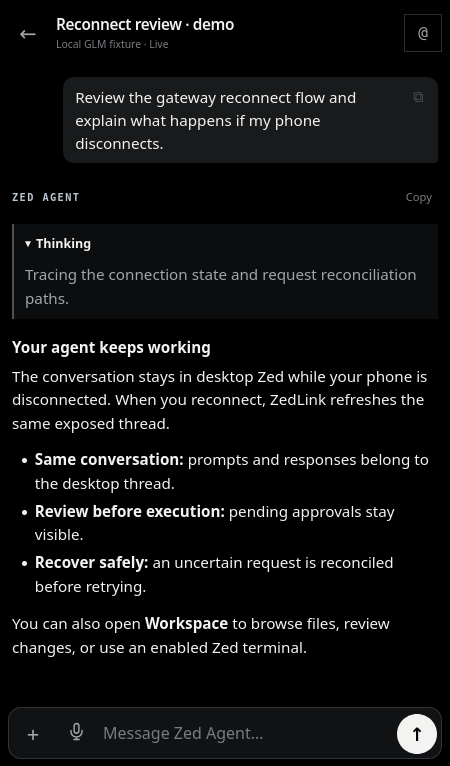
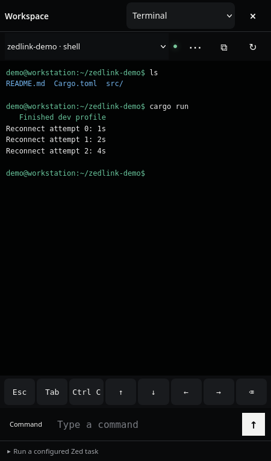
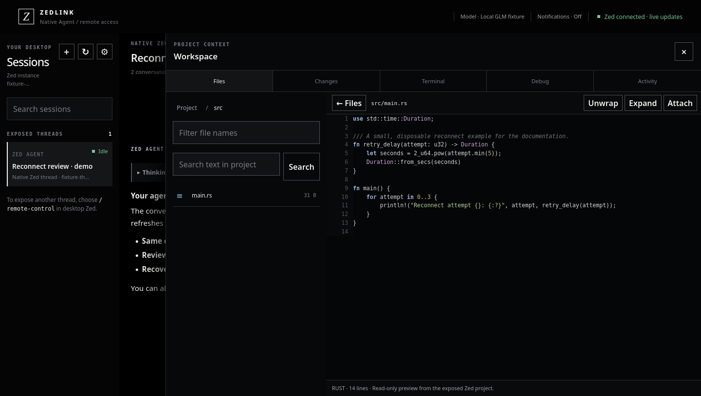
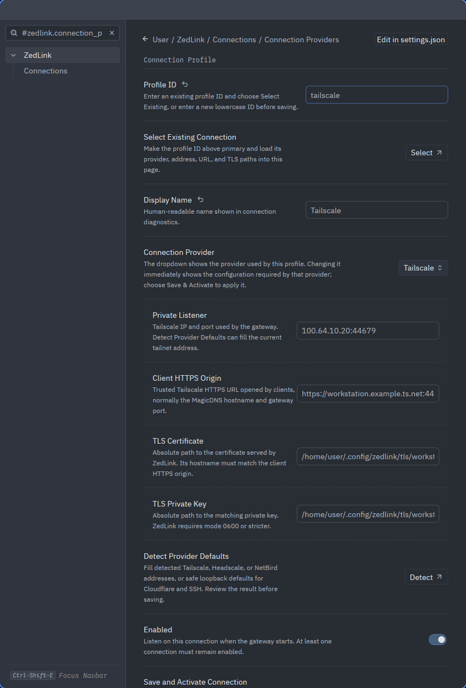

<div align="center">

# ZedLink

**Your Zed agent. The same conversation. Wherever you are.**

Continue an exposed Zed conversation from your phone, tablet, or browser.<br>
The agent, configured model, tools, and project stay in desktop Zed.

[Get started](wiki/Installation-and-Setup.md) · [Documentation](wiki/README.md) · [Mobile apps](wiki/Native-Mobile-Apps.md) · [Security](wiki/Security.md) · [Contribute](CONTRIBUTING.md)

**Browser / PWA** · **Linux host** · **iOS & Android source** · **Apache 2.0**

</div>

## See it in action

https://github.com/user-attachments/assets/eb599434-e283-4828-a300-e5e77d1c93f4

> [!IMPORTANT]
> ZedLink is development software and currently requires the [maintained Zed fork](https://github.com/tjnull/zed/tree/zedlink/native-agent-remote-control). It does not work as a Marketplace extension in stock Zed. The browser/PWA and Linux host are the most complete path; native mobile distribution and broader device validation are still in progress.

## Choose your client

| Client | Current status |
| --- | --- |
| Browser / installed web app | Most complete path. Connect over trusted HTTPS; no native app build required. |
| iOS | SwiftUI source with local Agent alerts and Apple Watch notification mirroring. Requires a macOS/Xcode build and signing; device validation is ongoing. |
| Android | Compose source and development APK builds. Terminal keyboard visibility and speech recording have unresolved device reports; the latest layout fix still needs verification. |

Native apps connect to the same gateway. Updating the gateway or website does **not** update an installed app: build and install a new native package. See [mobile setup and known issues](wiki/Native-Mobile-Apps.md).

## How it works

1. Open a project in patched Zed and explicitly expose an Agent conversation with `/remote-control`.
2. Start the local gateway and pair your device over trusted HTTPS.
3. Select that conversation remotely. Your messages enter the same Zed-hosted thread, using its existing model and permissions.

```text
Phone, tablet, or browser
          │  HTTPS / WebSocket + device pairing
          ▼
    ZedLink gateway
          │  private local Unix socket
          ▼
    Patched desktop Zed
          └─ Exposed conversation · configured model · tools · project
```

Zed must remain open. Disconnecting your phone does not stop the agent. ZedLink does not run a separate model client, and your model credentials remain on the host.

## What you can do

| Feature | What it gives you |
| --- | --- |
| Conversations | Continue native Zed Agent or configured Zed-hosted ACP conversations, including Codex and Claude Code |
| Live work | Read streamed responses, expandable thinking, tool output, errors, and pending approvals; stop a running turn |
| Workspace | Browse folders, read files, search project text, attach context, and review highlighted code and diffs |
| Terminal & debugger | Opt-in access to existing Zed terminals, configured tasks, and native debugger controls |
| Connections | Save gateway profiles, switch configured Zed targets, pair devices, and revoke access |
| Mobile input | Editable voice drafts, explicit text clipboard transfers, wrapped terminal output, and saved drafts |

Availability follows the selected agent and permissions advertised by the bridge. See [validation and remaining gaps](wiki/Roadmap-and-Validation.md) for limits, including native client parity and approval coverage.

## A closer look

<table>
  <tr>
    <td width="50%" align="center"><br><strong>Continue a conversation</strong></td>
    <td width="50%" align="center"><br><strong>Use an enabled Zed terminal</strong></td>
  </tr>
</table>



<details>
<summary><strong>Configure connections inside patched Zed</strong></summary>



Use ZedLink Settings to configure connections, check connectivity, manage gateway status and paired devices, and choose which remote controls are enabled.

</details>

*Browser images show the current UI with synthetic data in an isolated documentation fixture. They illustrate presentation, not real-model results or native app screenshots. See [screenshot provenance](assets/screenshots/README.md) and [recording details](assets/recordings/README.md).*

## Get started

**You need:** a Linux host, Rust/Cargo, Git, Python 3, [Zed build dependencies](wiki/Installation-and-Setup.md#before-you-begin), and a trusted HTTPS route reachable from your device. Tailscale is the recommended first setup. The first patched Zed build can take a while.

```sh
git clone https://github.com/tjnull/zedlink.git
cd zedlink
bash tools/setup_zed_ide.sh
```

The guided setup builds patched Zed and the gateway, configures the connection, and installs Zed tasks. For Tailscale, sign both devices into your tailnet and enable MagicDNS and HTTPS certificates first. Setup can provision certificates and install automatic renewal.

Then:

1. Launch **ZedLink — Patched Zed** and open the project you want to use.
2. Enable ZedLink in Settings and expose the desired conversation with `/remote-control`.
3. Start the gateway and choose **Pair a device**. Use either the browser QR page or the terminal QR option.
4. Open the trusted HTTPS address on your device, pair, and select the session.

For connection problems, use **Check Tailscale Connection** and **Guided Tailscale Repair** in ZedLink settings. The guided flow checks DNS, certificate trust, the active gateway certificate, and renewal before a separate phone-side HTTPS check. See the [connection repair guide](wiki/Connections-and-Networking.md#guided-tailscale-connection-checks-and-repair).

Follow the [installation guide](wiki/Installation-and-Setup.md) and [pairing guide](wiki/Running-and-Pairing.md) for the full walkthrough. Alternative VPNs and HTTPS routes are covered in [connections and networking](wiki/Connections-and-Networking.md).

## Security & status

- Network access alone never grants control: devices must pair, and TLS is required.
- Only explicitly exposed projects and conversations are available remotely.
- Terminal, debugger, and desktop clipboard access require their respective permissions.
- Zed remains authoritative for execution and approvals. Remote clients do not blanket-approve tools.

The Linux/browser path has local gateway fixtures and real patched-Zed tests; a physical iPhone Safari same-thread round trip over Tailscale has also been recorded. These results do not establish every feature on every client. Signed app releases, background notifications requiring push credentials, and broader physical-device testing remain pending. See [validation](wiki/Roadmap-and-Validation.md) and the [public-release checklist](wiki/Publishing-and-Upstream.md).

Report vulnerabilities through [SECURITY.md](SECURITY.md).

## Develop & contribute

The repository contains the gateway and web UI in `gateway/`, protocol types in `protocol-core/`, native client source in `ios/` and `android/`, and setup/test tools in `tools/`. The ignored `zed-source/` checkout comes from the maintained fork; the reviewable integration patch is in `patches/`.

```sh
bash tools/check_linux.sh
python3 tools/test_gateway_transport.py
python3 tools/check_public_release.py
```

Start with [CONTRIBUTING.md](CONTRIBUTING.md), [development and testing](wiki/Development-and-Testing.md), and the [Zed upstream proposal](wiki/Zed-Upstream-Proposal.md). The bridge is based on pinned upstream revision `c66312b200d113694fca08c1d468669028a09a0e`; see the proposal for the extension API gaps and core contribution path.

## Credits

Thank you to **Ringmast4r** and **diablo_rain** for helping test ZedLink and supporting the project. Their feedback helps identify device issues and improve the experience.

ZedLink builds on Zed and its contributors' work. See [credits](wiki/Credits.md) for acknowledgements and the separate licensing boundary.

## License

[Apache License 2.0](LICENSE). The separately maintained Zed fork retains its upstream licenses.
